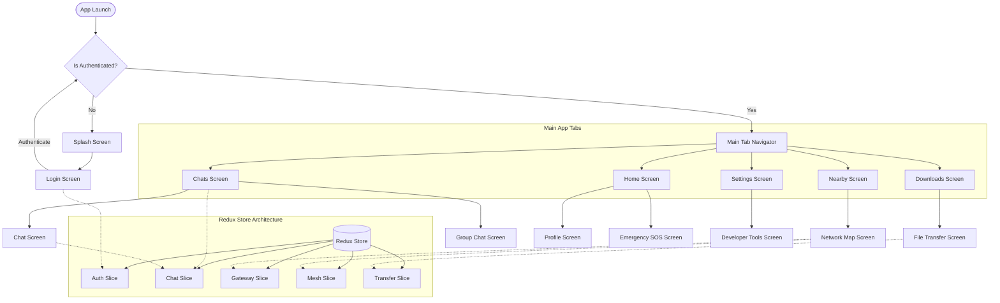

# JantarMantar Flowchart

Here is a high-level flowchart of the JantarMantar app's navigation and architecture, based on its React Native structure and Redux state.

### Architecture Highlights
- **Navigation:** The app utilizes `@react-navigation/native` with a root stack navigator distinguishing between unauthenticated (`Splash`, `Login`) and authenticated states.
- **Main Tabs:** Contains five core bottom tabs: `Home`, `Chats`, `Nearby`, `Downloads`, and `Settings`.
- **State Management:** Uses Redux (identified via `react-redux` and slices). State slices include `auth`, `chat`, `gateway`, `mesh`, and `transfer` to manage specific features.
- **Mesh/P2P Focus:** As observed from the `MeshOrchestrator` and specific screens (`NetworkMapScreen`, `NearbyScreen`), the app appears to facilitate decentralized or mesh network communications.
